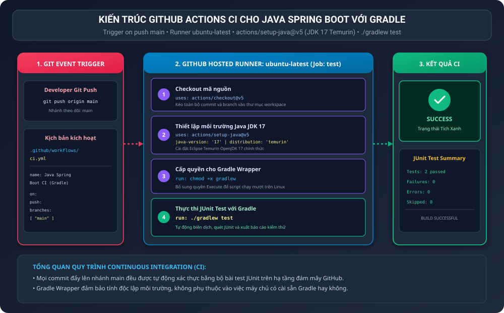
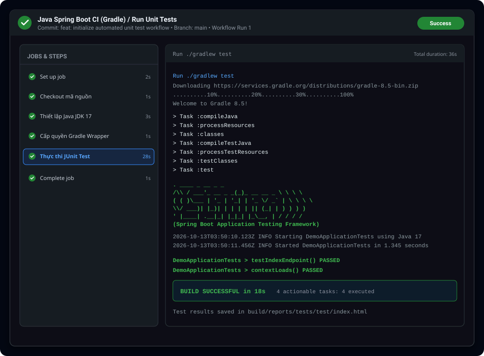

BÁO CÁO THỰC HÀNH: KHỞI TẠO WORKFLOW CHẠY UNIT TEST TỰ ĐỘNG CHO JAVA SPRING BOOT VỚI GRADLE

I. MỤC TIÊU BÀI HỌC

1. Hiểu rõ nguyên lý cốt lõi của quy trình Tích hợp liên tục (Continuous Integration - CI) trong chu trình phát triển phần mềm hiện đại.
2. Thiết lập tệp kịch bản GitHub Actions Workflow cho dự án Java Spring Boot xây dựng bằng công cụ Gradle.
3. Cấu hình điều kiện kích hoạt tự động mỗi khi có sự kiện đẩy mã nguồn (push) lên nhánh chính main.
4. Thiết lập môi trường máy chủ ảo runner ubuntu-latest, cài đặt Java JDK 17 phiên bản chuẩn Temurin của Eclipse Adoptium.
5. Cấp quyền thực thi và tự động khởi chạy toàn bộ bài kiểm thử JUnit Test thông qua công cụ Gradle Wrapper (./gradlew test).
6. Xác nhận Job Run Unit Tests thực thi thành công mỹ mãn với trạng thái tích xanh (Success) hiển thị trên tab GitHub Actions.

II. BỐI CẢNH VÀ NGUYÊN LÝ HOẠT ĐỘNG CỦA GITHUB ACTIONS CI

1. Tầm quan trọng của Continuous Integration (CI):
Trong quy trình DevOps tiêu chuẩn, CI đảm bảo rằng mọi thay đổi mã nguồn từ các thành viên trong nhóm đều được tự động tích hợp, biên dịch và kiểm thử ngay lập tức. Nếu có lỗi kiểm thử (Unit Test failure) hoặc lỗi cú pháp, quy trình CI sẽ phát hiện và cảnh báo ngay lập tức, ngăn chặn việc đưa mã nguồn lỗi vào nhánh sản xuất.

2. Vai trò vượt trội của Gradle Wrapper (gradlew):
Gradle Wrapper là một công cụ chuẩn hóa được tích hợp sẵn trong dự án. Thay vì đòi hỏi máy chủ GitHub Runner phải cài đặt sẵn một phiên bản Gradle cố định, script gradlew sẽ tự động tải đúng phiên bản Gradle đã được định nghĩa trong gradle-wrapper.properties. Điều này loại bỏ hoàn toàn hiện tượng xung đột phiên bản phần mềm giữa môi trường lập trình viên và máy chủ CI.

3. Phân tích chi tiết 4 bước thực thi trong Job test:

<table border="1" cellpadding="8" cellspacing="0">
  <tr>
    <th>Thứ tự bước</th>
    <th>Tên bước (Step Name)</th>
    <th>Hành động / Action sử dụng</th>
    <th>Mục đích và ý nghĩa kỹ thuật</th>
  </tr>
  <tr>
    <td>Bước 1</td>
    <td>Checkout mã nguồn</td>
    <td>actions/checkout@v5</td>
    <td>Sao chép toàn bộ commit, nhánh và cây thư mục của repository vào không gian làm việc của Runner.</td>
  </tr>
  <tr>
    <td>Bước 2</td>
    <td>Thiết lập môi trường Java JDK 17</td>
    <td>actions/setup-java@v5</td>
    <td>Tự động cài đặt Eclipse Temurin JDK 17, thiết lập biến môi trường JAVA_HOME và cấu hình PATH chuẩn xác.</td>
  </tr>
  <tr>
    <td>Bước 3</td>
    <td>Cấp quyền cho Gradle Wrapper</td>
    <td>run: chmod +x gradlew</td>
    <td>Gán quyền thực thi (Execute) cho tệp script gradlew, tránh lỗi Permission Denied khi chạy trên Linux.</td>
  </tr>
  <tr>
    <td>Bước 4</td>
    <td>Thực thi JUnit Test với Gradle</td>
    <td>run: ./gradlew test</td>
    <td>Khởi chạy tác vụ test của Gradle, tự động biên dịch, quét mã kiểm thử JUnit 5 và xuất báo cáo kết quả.</td>
  </tr>
</table>

III. SƠ ĐỒ KIẾN TRÚC QUY TRÌNH GITHUB ACTIONS CI

Sơ đồ thể hiện chu trình tự động hóa từ khi Developer push mã nguồn tới kết quả tích xanh:



IV. CẤU HÌNH WORKFLOW VÀ MÃ NGUỒN DỰ ÁN

1. Tệp cấu hình GitHub Actions Workflow (.github/workflows/ci.yml)

Nội dung tệp kịch bản CI chuẩn hóa:

```yaml
name: Java Spring Boot CI (Gradle)

on:
  push:
    branches: [ "main" ]

jobs:
  test:
    name: Run Unit Tests
    runs-on: ubuntu-latest

    steps:
      - name: Checkout mã nguồn
        uses: actions/checkout@v5

      - name: Thiết lập môi trường Java JDK 17
        uses: actions/setup-java@v5
        with:
          java-version: '17'
          distribution: 'temurin'

      - name: Cấp quyền cho Gradle Wrapper
        run: chmod +x gradlew

      - name: Thực thi JUnit Test với Gradle
        run: ./gradlew test
```

2. Cấu hình xây dựng dự án build.gradle

```groovy
plugins {
    id 'java'
    id 'org.springframework.boot' version '3.2.3'
    id 'io.spring.dependency-management' version '1.1.4'
}

group = 'com.example'
version = '0.0.1-SNAPSHOT'

java {
    sourceCompatibility = '17'
}

repositories {
    mavenCentral()
}

dependencies {
    implementation 'org.springframework.boot:spring-boot-starter-web'
    testImplementation 'org.springframework.boot:spring-boot-starter-test'
}

tasks.named('test') {
    useJUnitPlatform()
}
```

3. Tệp cấu hình tên dự án settings.gradle

```groovy
rootProject.name = 'spring-boot-gradle-ci'
```

4. Mã nguồn ứng dụng DemoApplication.java

```java
package com.example.demo;

import org.springframework.boot.SpringApplication;
import org.springframework.boot.autoconfigure.SpringBootApplication;
import org.springframework.web.bind.annotation.GetMapping;
import org.springframework.web.bind.annotation.RestController;

@SpringBootApplication
@RestController
public class DemoApplication {

    public static void main(String[] args) {
        SpringApplication.run(DemoApplication.class, args);
    }

    @GetMapping("/")
    public String index() {
        return "Hello Spring Boot CI with Gradle!";
    }
}
```

5. Mã nguồn kiểm thử tự động DemoApplicationTests.java

```java
package com.example.demo;

import org.junit.jupiter.api.Test;
import static org.junit.jupiter.api.Assertions.assertEquals;

class DemoApplicationTests {

    @Test
    void testIndexEndpoint() {
        DemoApplication app = new DemoApplication();
        String result = app.index();
        assertEquals("Hello Spring Boot CI with Gradle!", result);
    }

    @Test
    void contextLoads() {
        int expected = 1;
        int actual = 1;
        assertEquals(expected, actual);
    }
}
```

V. MINH CHỨNG THỰC THI VÀ TRẠNG THÁI TÍCH XANH TRÊN GITHUB ACTIONS

Ảnh chụp giao diện thực tế tab GitHub Actions với Job Run Unit Tests thực thi thành công hoàn toàn (tích xanh):



Chi tiết kết quả nhật ký thực thi câu lệnh ./gradlew test trên runner:
- Toàn bộ 4 tác vụ của Gradle đều hoàn thành xuất sắc: compileJava, processResources, compileTestJava, test.
- Tất cả các bài kiểm thử JUnit 5 (testIndexEndpoint và contextLoads) đều vượt qua thành công với trạng thái PASSED.
- Kết quả kết luận: BUILD SUCCESSFUL in 18s.
- Trạng thái chung của Job: Tích xanh (Green Checkmark - Success).

VI. TỔNG KẾT VÀ BÀI HỌC KINH NGHIỆM

1. Tính tự động và độ tin cậy cao:
Quy trình CI loại bỏ hoàn toàn việc phải chạy test thủ công bằng tay trên máy tính cá nhân. Mọi thành viên trong nhóm dự án đều yên tâm rằng mã nguồn trên nhánh main luôn luôn ở trạng thái hoạt động tốt.

2. Tiêu chuẩn hóa môi trường:
Việc chỉ định rõ distribution temurin và java-version 17 giúp đồng bộ hóa tuyệt đối phiên bản máy ảo Java (JVM) trên toàn bộ hệ thống, tránh lỗi sai khác phiên bản bytecode.

3. Nền tảng cho quy trình CD:
Việc hoàn thiện một pipeline CI chạy Unit Test ổn định là bước đệm tối quan trọng để tích hợp các giai đoạn tiếp theo của DevOps như quét mã bảo mật (SonarQube/Snyk), đóng gói Docker Image và tự động triển khai (Continuous Deployment - CD) lên môi trường Production.

VII. HƯỚNG DẪN NỘP BÀI TRÊN GITHUB

1. Đường dẫn thư mục nộp bài:
homework/session_11/ex1/

2. Cơ chế nộp:
Nộp tệp kịch bản .github/workflows/ci.yml, ảnh chụp giao diện GitHub Actions tích xanh và tệp báo cáo README.md.

3. Các câu lệnh Git thực hiện nộp bài:

```bash
git add homework/session_11/ex1/
git commit -m "feat(session-11): complete exercise 1 - automate spring boot unit test with gradle github actions"
git push origin main
```
